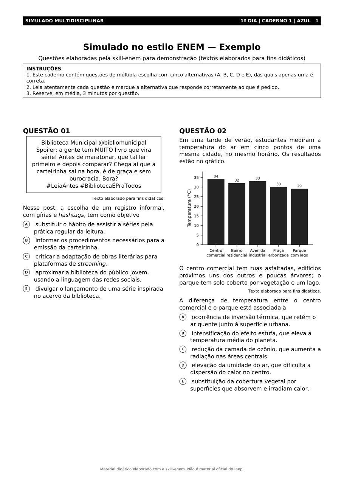
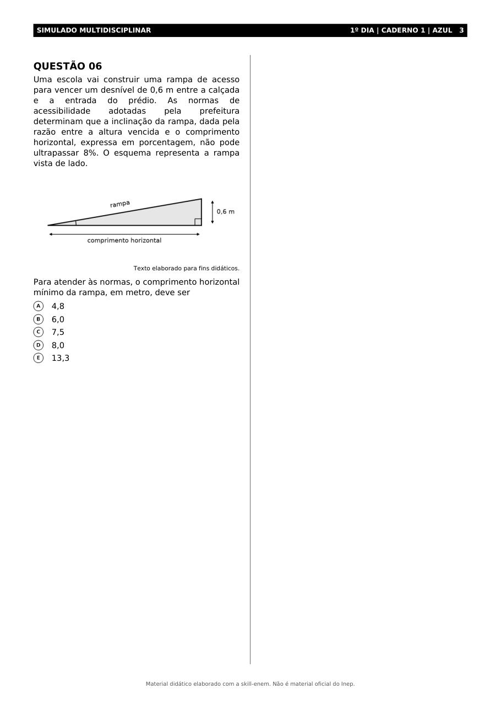

# skill-enem · Questões no padrão ENEM para professores

**Skill gratuita e de código aberto** que faz o Claude (e o ChatGPT) elaborar **itens inéditos idênticos ao estilo
do ENEM** e entregar **sempre um Word (.docx) e um PDF** no layout do caderno de prova: faixa da área, duas colunas,
"QUESTÃO 01", alternativas com a letra no círculo, gráficos, tabelas e figuras, gabarito comentado e ficha técnica.

Baseada nos documentos oficiais do INEP (Matriz de Referência, Guia de Elaboração e Revisão de Itens, Procedimentos
de Análise e Guia da TRI) e na análise de **3.510 itens** das provas regulares de 2009 a 2025.

```
/skill-enem 5 questões de Química sobre pH, dificuldade média, com um gráfico
```

| Página 1 do PDF gerado | Questão com figura geométrica |
|---|---|
|  |  |

Exemplo completo: [PDF](exemplos/saida/simulado-exemplo.pdf) · [Word](exemplos/saida/simulado-exemplo.docx) ·
[LaTeX](exemplos/saida/simulado-exemplo.tex) · [JSON de origem](exemplos/simulado-exemplo.json)

> Material não oficial. Este projeto não tem vínculo com o Inep ou o MEC. Os arquivos gerados trazem esse aviso no rodapé.

---

## Sumário
- [O que a skill faz](#o-que-a-skill-faz)
- [Instalação](#instalação)
  - [Claude (site e aplicativo)](#1-claude-site-e-aplicativo--claudeai)
  - [Claude Code pelo chat (plugin)](#2-claude-code-pelo-chat-plugin)
  - [Terminal: macOS, Linux e Windows](#3-terminal-macos-linux-e-windows)
  - [ChatGPT](#4-chatgpt)
  - [Instalação manual](#5-instalação-manual)
- [Como usar](#como-usar)
- [O que vem em cada questão](#o-que-vem-em-cada-questão)
- [Word, PDF e LaTeX](#word-pdf-e-latex)
- [Gráficos e imagens (e o custo de cada um)](#gráficos-e-imagens-e-o-custo-de-cada-um)
- [Ferramentas extras para o professor](#ferramentas-extras-para-o-professor)
- [Base técnica: INEP, provas e TRI](#base-técnica-inep-provas-e-tri)
- [Estrutura do repositório](#estrutura-do-repositório)
- [Limites e uso responsável](#limites-e-uso-responsável)
- [Para quem mantém o repositório](#para-quem-mantém-o-repositório)
- [Licença](#licença)

---

## O que a skill faz

- **Gera itens inéditos** de Linguagens (inclusive inglês e espanhol), Ciências Humanas, Ciências da Natureza e
  Matemática, cada um ligado a **uma habilidade** da Matriz de Referência (ex.: `CN-H17`).
- Segue as **regras oficiais do BNI/INEP**: situação-problema contextualizada, comando sem negativas, cinco
  alternativas paralelas, gabarito único e **distratores plausíveis**, cada um baseado num erro real de raciocínio.
- **Imita o estilo das provas**: comandos típicos de cada área, tamanho dos textos, formato das referências,
  "o(a)" para não denunciar o gabarito, alternativas numéricas ordenadas.
- **Estima a dificuldade** pela lógica da TRI (fácil/médio/difícil e faixa do parâmetro *b* na escala 500/100).
- **Entrega Word + PDF** (e o `.tex`) com o layout do caderno, gráficos, tabelas e figuras.
- **Monta simulados** de 45 itens com cobertura da matriz, dificuldade graduada e gabarito equilibrado.
- **Revisa questões** do professor (diagnóstico pelo checklist do INEP + versão melhorada).
- **Cria versões** fácil, média e difícil de uma mesma questão.
- **Analisa as respostas da turma** com os mesmos índices que o INEP usa no pré-teste (TCT).
- **Explica a TRI** para alunos e professores, sem prometer "nota oficial".

## Instalação

Escolha **um** caminho. Todos são gratuitos.

### 1. Claude (site e aplicativo) · claude.ai

1. Baixe **`skill-enem.zip`** na página [Releases](../../releases/latest) deste repositório (não descompacte).
2. No Claude, abra **Configurações → Capacidades** e ative **Execução de código e criação de arquivos**
   (é ela que gera o Word e o PDF).
3. Na mesma tela, em **Skills**, clique em **Enviar skill** e selecione o `skill-enem.zip`.
4. Ative a skill e, em qualquer conversa, digite:
   ```
   /skill-enem 3 questões de História sobre a Era Vargas
   ```
   Pedir "questões estilo ENEM sobre…" também ativa a skill automaticamente.

> O nome dos menus pode mudar um pouco com as atualizações do Claude. Se não encontrar, procure por "Skills" nas configurações.

### 2. Claude Code pelo chat (plugin)

Dentro do Claude Code (terminal, aplicativo de desktop ou extensão do VS Code), digite no chat:

```
/plugin marketplace add SEU-USUARIO/questoes-enem-skill
/plugin install skill-enem@skill-enem
```

Depois use `/skill-enem …` (em algumas versões o comando aparece como `/skill-enem:skill-enem`).

### 3. Terminal: macOS, Linux e Windows

**macOS e Linux** (Terminal):

```bash
curl -fsSL https://raw.githubusercontent.com/SEU-USUARIO/questoes-enem-skill/main/install/install.sh | bash -s -- --deps
```

**Windows** (PowerShell):

```powershell
irm https://raw.githubusercontent.com/SEU-USUARIO/questoes-enem-skill/main/install/install.ps1 | iex
```

Para instalar também as bibliotecas Python no Windows, baixe o `install.ps1` e rode `.\install.ps1 -Deps`.

Opções dos instaladores:

| macOS/Linux | Windows | O que faz |
|---|---|---|
| `--claude` (padrão) | `-Claude` | Claude Code: `~/.claude/skills/skill-enem` |
| `--codex` | `-Codex` | OpenAI Codex CLI: `~/.codex/skills/skill-enem` |
| `--agents` | `-Agents` | pasta genérica `~/.agents/skills` (outros agentes compatíveis) |
| `--projeto` | `-Projeto` | só no projeto atual: `./.claude/skills` |
| `--todos` | `-Todos` | todos os destinos acima |
| `--deps` | `-Deps` | instala `python-docx`, `matplotlib`, `reportlab`, `pymupdf` |
| `--desinstalar` | `-Desinstalar` | remove a skill |

Depois, abra o Claude Code (`claude`) e digite `/skill-enem …`. No Codex CLI, peça "use a skill-enem para…".

### 4. ChatGPT

O ChatGPT usa um **GPT personalizado**, e as instruções e os arquivos já estão prontos:

1. Baixe **`skill-enem-chatgpt.zip`** em [Releases](../../releases/latest) e descompacte.
2. Siga o passo a passo de [`gpt/COMO-CRIAR-O-GPT.md`](gpt/COMO-CRIAR-O-GPT.md): cole as instruções, envie os
   arquivos de conhecimento e ative o **Interpretador de código** (obrigatório para gerar Word e PDF).
3. Compartilhe o link do seu GPT com outros professores, se quiser.

### 5. Instalação manual

Copie a pasta [`skills/skill-enem`](skills/skill-enem) para a pasta de skills da sua ferramenta
(ex.: `~/.claude/skills/`). A skill segue o padrão aberto `SKILL.md` (pasta com `SKILL.md`, `references/`,
`scripts/` e `assets/`).

## Como usar

Comece a mensagem com **`/skill-enem`** e descreva o que precisa. Exemplos:

```
/skill-enem 5 questões de Biologia sobre vacinas, nível médio
/skill-enem 10 questões de Matemática sobre porcentagem com gráficos e tabelas, para 3ª série
/skill-enem simulado de Ciências Humanas com 45 questões, gabarito em arquivo separado
/skill-enem 2 questões de inglês (língua estrangeira) sobre mudanças climáticas
/skill-enem questão de Física (habilidade CN-H21) em três versões: fácil, média e difícil
/skill-enem revise esta questão da minha prova: [cole a questão]
/skill-enem use este texto como base e faça 3 itens com habilidades diferentes: [cole o texto e a referência]
/skill-enem explique para meus alunos como a TRI calcula a nota
```

Se você não disser a habilidade, a dificuldade ou o formato, a skill escolhe e informa na ficha técnica.

## O que vem em cada questão

1. **Texto-base** (verbal e/ou gráfico, tabela, esquema), com a **referência** no padrão das provas, ou a
   indicação "Texto elaborado para fins didáticos".
2. **Comando** no estilo da área.
3. **Alternativas A–E**, com gabarito único e quatro distratores plausíveis.
4. **Gabarito comentado**: por que cada alternativa está certa ou errada, e qual erro cada distrator representa.
5. **Ficha técnica**: área, competência, habilidade, eixo cognitivo, objeto de conhecimento, dificuldade estimada,
   parâmetro *b* estimado e tempo médio.

## Word, PDF e LaTeX

A skill monta a prova num JSON e roda `scripts/gerar_prova.py`, que gera **três arquivos**:

| Arquivo | Como é feito |
|---|---|
| `.tex` | Fonte LaTeX (duas colunas, cabeçalho, TikZ/pgfplots). Abre no [Overleaf](https://www.overleaf.com) (compile com XeLaTeX). |
| `.pdf` | Compilado com **LaTeX** quando existe (tectonic, xelatex, lualatex ou pdflatex). Sem LaTeX, usa o **LibreOffice** (Word→PDF) ou o **ReportLab**, com o mesmo layout. |
| `.docx` | Word editável com duas colunas, faixa da área, figuras, tabelas e gabarito. |

No Claude (site) e no ChatGPT, tudo isso roda no ambiente de código da própria plataforma: você só baixa os arquivos.
No computador, o gerador precisa de Python 3 e de:

```bash
pip install python-docx matplotlib reportlab pymupdf
```

LaTeX é **opcional** (melhora o acabamento do PDF). A forma mais leve é o [Tectonic](https://tectonic-typesetting.github.io).
Você também pode usar o gerador por conta própria:

```bash
python skills/skill-enem/scripts/gerar_prova.py minha-prova.json --saida saida --nome simulado
python skills/skill-enem/scripts/gerar_prova.py minha-prova.json --gabarito separado   # caderno do aluno + gabarito
```

O formato do JSON está em [`references/formatos-de-saida.md`](skills/skill-enem/references/formatos-de-saida.md),
e há um modelo pronto em [`assets/modelo-prova.json`](skills/skill-enem/assets/modelo-prova.json).

## Gráficos e imagens (e o custo de cada um)

| Tipo de figura | Como a skill faz | Custo |
|---|---|---|
| Gráficos (barras, linhas, setores, dispersão) | código (matplotlib / pgfplots) | **nenhum extra** |
| Tabelas e quadros | código | **nenhum extra** |
| Figuras geométricas, esquemas, circuitos | código (`desenho` ou TikZ) | **nenhum extra** |
| Fotos, pinturas, charges, tirinhas, cartazes | imagem enviada pelo professor; ou geração por IA **só se você pedir** | gerar imagem com IA consome créditos ou limites do seu plano |

Sem imagem disponível, a skill coloca uma **caixa com a descrição detalhada** da figura, para você inserir uma
imagem no Word. Imagens geradas por IA são marcadas como "Imagem ilustrativa gerada por IA".

## Ferramentas extras para o professor

Todas ficam em `skills/skill-enem/scripts/` e as três primeiras não exigem instalar nada além do Python.

```bash
# Confere se as questões seguem as regras do INEP (comando negativo, 5 alternativas, ordem numérica, referências...)
python validar_item.py minha-prova.json

# Depois de aplicar o simulado: % de acerto, discriminação, bisserial por alternativa, acerto por habilidade
python analisar_respostas.py respostas.csv --prova minha-prova.json

# Mostra na prática por que dois alunos com o mesmo número de acertos têm notas diferentes na TRI
python simular_tri.py --demo
```

Formato do `respostas.csv` (vírgula ou ponto e vírgula; aceita exportação do Google Forms ou de planilhas):

```
nome,Q1,Q2,Q3,Q4
Ana,A,C,B,E
Bruno,B,C,B,D
```

## Base técnica: INEP, provas e TRI

- **Matriz de Referência do Enem** (INEP, 2026): 5 eixos cognitivos, 30 competências de área, 120 habilidades e os
  objetos de conhecimento, transcritos em [`matriz-de-referencia.md`](skills/skill-enem/references/matriz-de-referencia.md).
- **Guia de Elaboração e Revisão de Itens** (INEP/BNI, 2010): estrutura do item, regras do texto-base, do comando e
  das alternativas, e ficha de revisão. Resumido em [`anatomia-do-item.md`](skills/skill-enem/references/anatomia-do-item.md)
  e [`checklist-revisao.md`](skills/skill-enem/references/checklist-revisao.md).
- **Enem: Procedimentos de Análise** (INEP, 2021) e **Entenda a sua nota no Enem** (INEP, 2021): modelo logístico de
  3 parâmetros, EAP, escala 500/100, coerência pedagógica, TCT e bisserial. Resumidos em
  [`tri-e-dificuldade.md`](skills/skill-enem/references/tri-e-dificuldade.md).
- **Provas e gabaritos 1998–2025** (página oficial do INEP): 49 cadernos analisados, 3.510 itens da era TRI.
  Resultados em [`estatisticas-provas.md`](skills/skill-enem/references/estatisticas-provas.md); para reproduzir,
  rode [`ferramentas/analisar_corpus.py`](ferramentas/analisar_corpus.py).

Links oficiais:
[Provas e gabaritos](https://www.gov.br/inep/pt-br/areas-de-atuacao/avaliacao-e-exames-educacionais/enem/provas-e-gabaritos) ·
[Matriz de Referência](https://download.inep.gov.br/enem/outros_documentos/enem_matriz_de_referencia_v1.pdf) ·
[Entenda a sua nota (TRI)](https://download.inep.gov.br/publicacoes/institucionais/avaliacoes_e_exames_da_educacao_basica/entenda_a_sua_nota_no_enem_guia_do_participante.pdf) ·
[Procedimentos de análise](https://download.inep.gov.br/publicacoes/institucionais/avaliacoes_e_exames_da_educacao_basica/enem_procedimentos_de_analise.pdf)

## Estrutura do repositório

```
questoes-enem-skill/
├── skills/skill-enem/              ← a skill (é isto que vai para o Claude/Codex)
│   ├── SKILL.md                    ← instruções principais e comando /skill-enem
│   ├── references/                 ← matriz, regras do item, padrões por área, TRI, checklist, formatos, estatísticas
│   ├── scripts/                    ← gerar_prova.py, validar_item.py, analisar_respostas.py, simular_tri.py
│   └── assets/modelo-prova.json    ← modelo de JSON com gráfico, tabela, desenho e TikZ
├── gpt/                            ← instruções e passo a passo do GPT personalizado (ChatGPT)
├── install/                        ← install.sh (macOS/Linux) e install.ps1 (Windows)
├── .claude-plugin/                 ← plugin.json e marketplace.json (instalação pelo chat do Claude Code)
├── exemplos/                       ← simulado de exemplo (JSON) e arquivos gerados (PDF, DOCX, TEX)
├── ferramentas/                    ← empacotar.py (gera os .zip) e analisar_corpus.py (análise das provas)
└── .github/workflows/release.yml   ← testes automáticos e publicação dos .zip a cada versão
```

## Limites e uso responsável

- **Revise sempre** as questões antes de aplicar: a IA pode errar conceitos ou cálculos. A skill confere os
  cálculos e aplica um checklist, mas a revisão do professor é insubstituível.
- A **dificuldade é estimada**, não medida. Parâmetros reais da TRI só existem depois de aplicar o item a muitos
  estudantes. Nenhuma ferramenta calcula a "nota oficial do ENEM" de um simulado.
- **Referências nunca são inventadas.** Quando não há texto real verificado, o texto-base é marcado como
  "Texto elaborado para fins didáticos".
- Os itens são **inéditos**: a skill não copia questões do ENEM, que servem só de referência de estilo.
- Respeite direitos autorais ao inserir imagens e textos (trechos curtos, com fonte, para fins didáticos).

## Para quem mantém o repositório

1. Troque `SEU-USUARIO` pelo seu usuário do GitHub em todo o projeto:
   ```bash
   grep -rl "SEU-USUARIO" . --exclude-dir=.git | xargs sed -i.bak "s/SEU-USUARIO/seu-usuario/g" && find . -name "*.bak" -delete
   ```
2. Crie o repositório público `questoes-enem-skill` no GitHub e envie o código (`git push`).
3. Publique uma versão: `git tag v1.1.0 && git push --tags`. O GitHub Actions testa tudo (inclusive a compilação
   LaTeX) e anexa `skill-enem.zip` e `skill-enem-chatgpt.zip` à página de Releases.
4. Para gerar os .zip localmente: `python ferramentas/empacotar.py` (saem em `dist/`).

Contribuições são bem-vindas: abra uma *issue* com sugestões, erros encontrados ou exemplos de itens.

## Licença

[MIT](LICENSE): use, modifique e distribua livremente, inclusive em escolas e cursinhos, mantendo o aviso de licença.
Os documentos do INEP citados são públicos e podem ser reproduzidos com citação da fonte.
